---
## Front matter
title: "Лабораторная работа № 7. Расширенные настройки межсетевого экрана"
subtitle: "Отчет"
author: "Анна Александровна Глушенок"

## Generic options
lang: ru-RU
toc-title: "Содержание"

## Pdf output format
toc: true
toc-depth: 2
lof: true
lot: false
fontsize: 12pt
linestretch: 1.5
papersize: a4
documentclass: scrreprt

## I18n babel
babel-lang: russian
babel-otherlangs: english

## Fonts
mainfont: Liberation Serif
sansfont: Liberation Sans
monofont: Liberation Mono

## Pandoc-crossref LaTeX customization
figureTitle: "Рис."
tableTitle: "Таблица"
lofTitle: "Список иллюстраций"

## Misc options
indent: true
header-includes:
  - \usepackage{indentfirst}
  - \usepackage{float}
  - \floatplacement{figure}{H}
---

# Цель работы

Получить навыки настройки межсетевого экрана в Linux в части переадресации портов и настройки Masquerading.

# Задание

1. Настройте межсетевой экран виртуальной машины server для доступа к серверу по протоколу SSH не через 22-й порт, а через порт 2022 (см. разделы 7.4.1 и 7.4.2).
2. Настройте Port Forwarding на виртуальной машине server (см. разделы 7.4.3).
3. Настройте маскарадинг на виртуальной машине server для организации доступа клиента к сети Интернет (см. раздел 7.4.3).
4. Напишите скрипт для Vagrant, фиксирующий действия по расширенной настройке межсетевого экрана. Соответствующим образом внести изменения в Vagrantfile (см. раздел 7.4.4).

# Выполнение лабораторной работы

## Создание пользовательской службы firewalld

1. Загрузите ОС и перейдите в рабочий каталог: cd /var/tmp/user_name/vagrant
2. Запустите ВМ server: vagrant up server 
3. На ВМ server войдите под вашим пользователем, откройте терминал, перейдите в режим суперпользователя: sudo -i

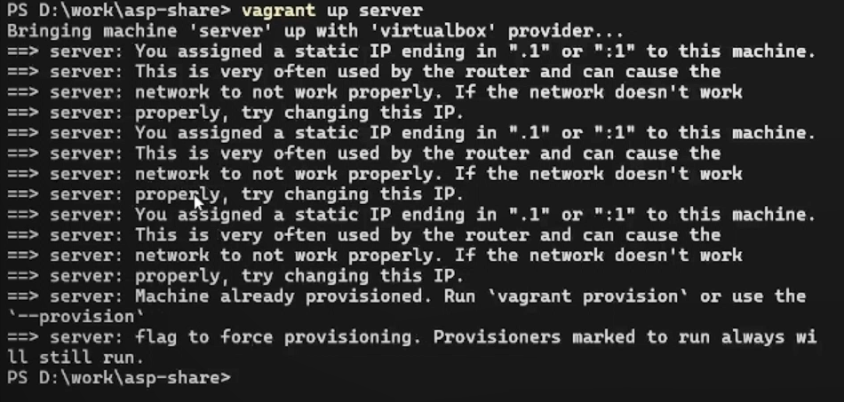{#fig:001 width=60%}

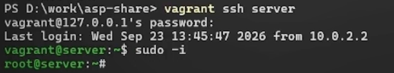{#fig:002 width=60%}

4. На основе существующего файла описания службы ssh создайте файл с собственным описанием

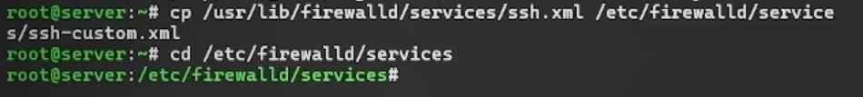{#fig:003 width=60%}

5. Посмотрите содержимое файла службы: cat /etc/firewalld/services/ssh-custom.xml

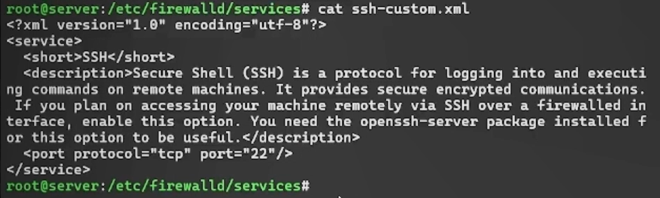{#fig:004 width=60%}

Принцип синтаксиса файла описания службы:  
- xml — заголовок: версия XML и кодировка.  
- service — корневой тег: контейнер для описания службы.  
- short — краткое имя службы (для отображения).  
- description — текстовое описание (справочная информация).  
- port — правило: какой порт (22) и протокол (tcp) открыть.  

6. Откройте файл описания службы на редактирование и замените порт 22 на порт 2022, скорректируйте описание службы

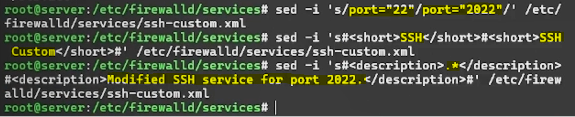{#fig:005 width=60%}

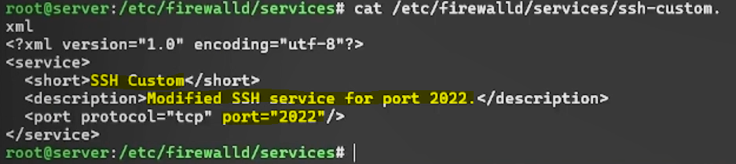{#fig:006 width=60%}

7. Просмотрите список доступных FirewallD служб: firewall-cmd --get-services (ssh-custom еще НЕ отображается в списке доступных)
8. Перегрузите правила межсетевого экрана с сохранением информации о состоянии и вновь выведите список доступных служб, а также список активных служб (ssh-custom отображается в списке доступных, но НЕ активирована)

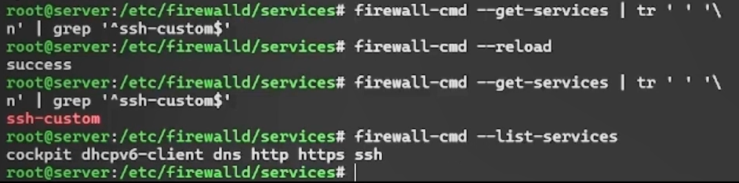{#fig:007 width=60%}

9. Добавьте новую службу в FirewallD и выведит список активных служб (ssh-custom добавлена и активна)

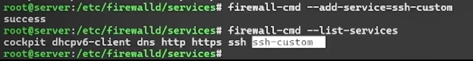{#fig:008 width=60%}

10. Если служба добавлена в FirewallD, то перегрузите правила межсетевого экрана с сохранением информации о состоянии

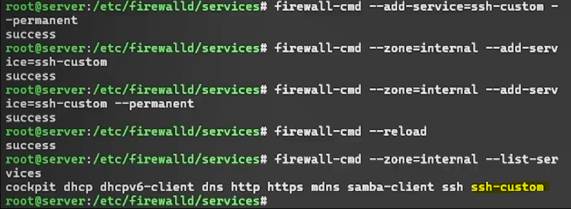{#fig:009 width=60%}

## Перенаправление портов

1. Организуйте на сервере переадресацию с порта 2022 на порт 22: firewall-cmd --add-forward-port=port=2022:proto=tcp:toport=22

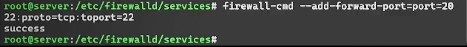{#fig:010 width=60%}

2. На клиенте попробуйте получить доступ по SSH к серверу через порт 2022: ssh -p 2022 user@server.aaglushenok.net

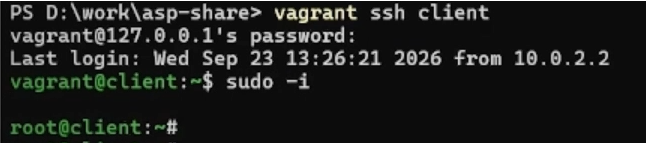{#fig:011 width=60%}

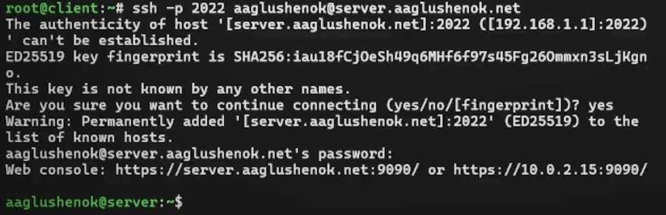{#fig:012 width=60%}

## Настройка Port Forwarding и Masquerading

1. На сервере посмотрите, активирована ли в ядре системы возможность перенаправления IPv4-пакетов пакетов: sysctl -a | grep forward
2. Включите перенаправление IPv4-пакетов на сервере

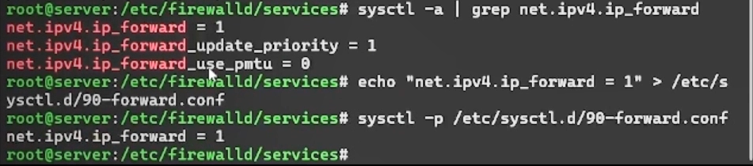{#fig:013 width=60%}

3. Включите маскарадинг на сервере: firewall-cmd --zone=public --add-masquerade --permanent

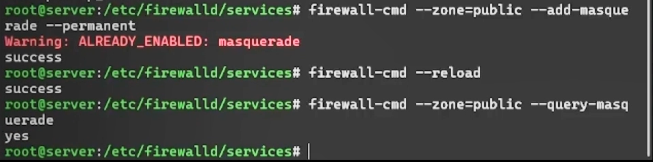{#fig:014 width=60%}

4. На клиенте проверьте доступность выхода в Интернет (клиент получил ответ от внешнего сервера, что подтверждает успешный проход трафика через шлюз (сервер) в Интернет

Проверка через ping:  успешный ответ от 8.8.8.8 (0% потерь) означает, что ICMP-пакеты от клиента дошли до внешнего сервера и вернулись обратно, это подтверждает  что шлюз (сервер) корректно перенаправляет трафик в Интернет.

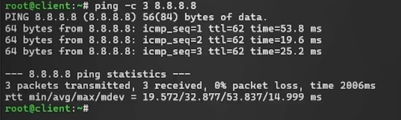{#fig:015 width=60%}

Проверка через http-запрос: клиент получил ответ от внешнего сервера, это подтверждает успешный проход трафика через шлюз (сервер) в Интернет.

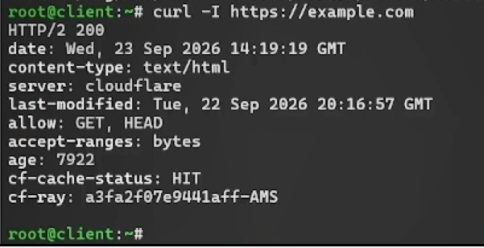{#fig:016 width=60%}

## Внесение изменений в настройки внутреннего окружения виртуальной машины

1. На ВМ server перейдите в каталог для внесения изменений в настройки внутреннего окружения /vagrant/provision/server/, создайте в нём каталог firewall, в который поместите в соответствующие подкаталоги конфигурационные файлы FirewallD

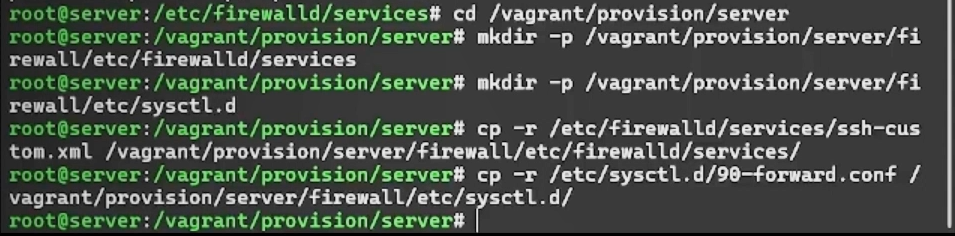{#fig:017 width=60%}

2. В каталоге /vagrant/provision/server создайте файл firewall.sh

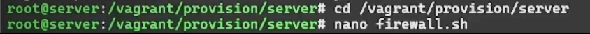{#fig:018 width=60%}

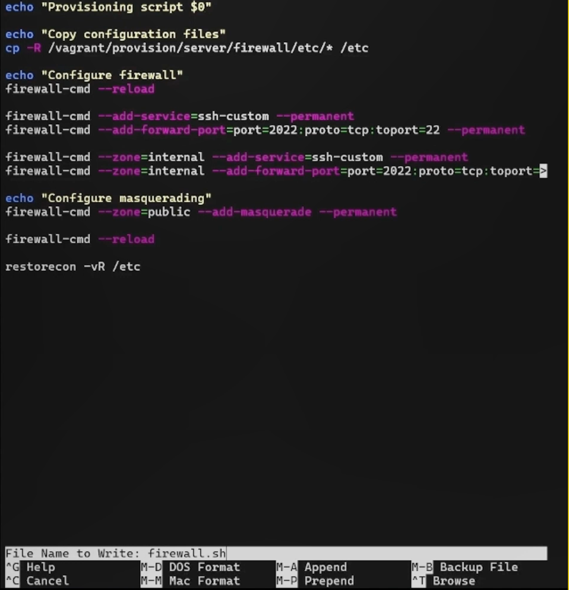{#fig:019 width=60%}

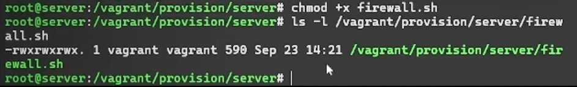{#fig:020 width=60%}

3. Для отработки созданного скрипта во время загрузки ВМ server в конфигурационном файле Vagrantfile необходимо изменить конфигурации для сервера

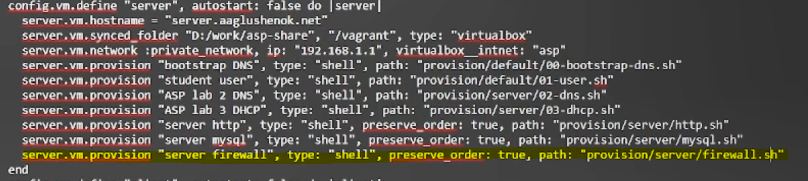{#fig:021 width=60%}

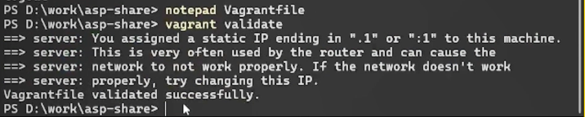{#fig:022 width=60%}

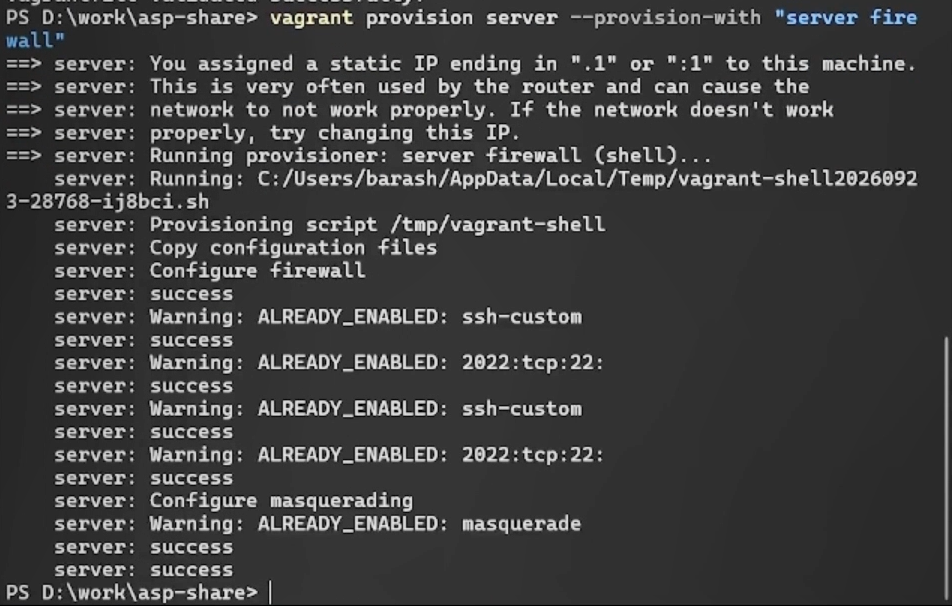{#fig:023 width=60%}

# Выводы

В ходе выполнения лабораторной работы № 7 мне удалось получить навыки настройки межсетевого экрана в Linux в части переадресации портов и настройки Masquerading.
